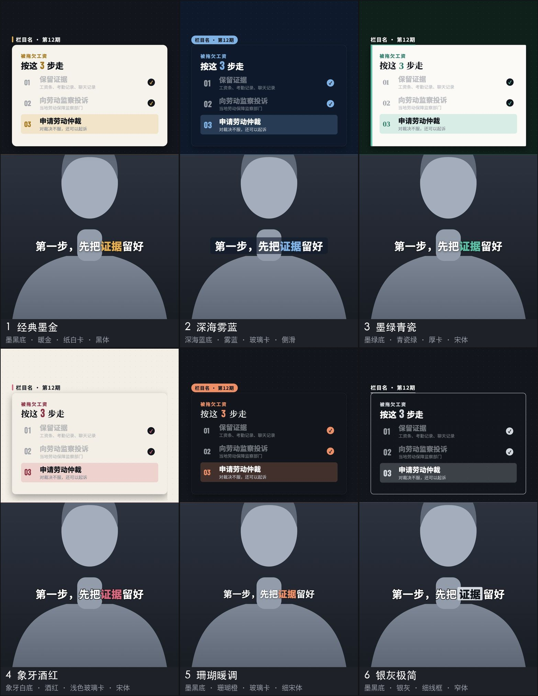

# 口播剪辑模板合集 · 吃token的皮卡秋

把**原始口播素材**交给 AI，在 [ChatCut](https://chatcut.io) 里直接剪成带动效、字幕、音效的竖屏短视频。每套模板是一个 AI 助手能用的 Skill，免费分享。

觉得有用的话，点右上角的 ☆ Star，让更多做口播的人看到。

## 模板

| 模板 | 风格 | 适合 | 版本 |
|---|---|---|---|
| [白板便签风](whiteboard-koubo/)（`whiteboard-koubo`） | 方格纸、便签、手写字、真实纸笔音效，人物缩进右下圆圈 | 方法论、清单干货、教程、AI 工具分享 | 1.0.3 |
| [高级感干货风](premium-talk-edit/)（`premium-talk-edit`） | 深色底、米色信息卡、单一强调色，克制、专业、可信；28 种信息卡 | 律师、医生、财税、保险、教育、职场等专业干货 | 0.2.0 |

<table><tr>
<td width="50%"> 白板便签风</td>
<td width="50%"> 高级感干货风</td>
</tr></table>

每套模板的详细介绍、示例和已知限制，点进对应文件夹看它的 README。

## 需要准备

| 东西 | 说明 |
|---|---|
| ChatCut Desktop | 剪辑、转写、字幕、导出都在 ChatCut 里完成。支持 macOS 13+ 和 Windows 10+（x64），需要注册登录。卡片和动效靠 ChatCut 渲染，剪映、Premiere 等别的软件用不了 |
| 一个能用 Skill 的 AI 助手 | 例如 Cindy、Claude Code、Codex、WorkBuddy，并接好 ChatCut 的工具（MCP） |
| Python 3 | 脚本只用标准库，不用另装 Python 包 |
| ffmpeg（**仅 Windows 需要**） | 用来读音频。macOS 不用装，用系统自带的 afconvert；Windows 上装：`winget install Gyan.FFmpeg`，装好后重开终端 |

字体不用装，ChatCut 会按名字自动下载开源字体。

## 安装

**第一步：装 ChatCut。** 在你的 AI 助手里新开一个对话，发送：

> 阅读 ChatCut.io/desktop，帮我安装 ChatCut

它会运行 ChatCut 官方安装脚本，装好后打开 ChatCut，你在弹出的浏览器里登录。想自己装的话，macOS 在终端运行 `curl -fsSL https://chatcut.io/install.sh | sh`，Windows 在 PowerShell 运行 `irm https://chatcut.io/install.ps1 | iex`。

**第二步：装模板。** 想用哪套，就对 AI 助手说哪句：

> 帮我安装这个剪辑 Skill：https://github.com/yyue5578-coder/koubo-templates/tree/main/whiteboard-koubo

> 帮我安装这个剪辑 Skill：https://github.com/yyue5578-coder/koubo-templates/tree/main/premium-talk-edit

两套可以都装，互不影响。装完**新开一个对话**再开始剪，AI 助手只在对话开始时加载 Skill 和 ChatCut 的工具。想自己手动装，看各模板文件夹里的说明。

## 要花多少钱

- **ChatCut 积分：不花。** 按 [ChatCut 官方积分说明](https://chatcut.io/zh/docs/credits-policy)，上传、剪辑、转写、字幕和导出都不消耗积分；这两套模板都不调用 ChatCut 的付费生成，音效用的是模板自带的录音。
- **AI 助手的用量：** 用你自己的 AI 助手套餐或 API 额度，剪一条片子要调用几十到上百次工具，具体看模型和助手。

## 许可

两套模板都采用 [CC BY-NC 4.0](https://creativecommons.org/licenses/by-nc/4.0/deed.zh-hans)（署名—非商业性使用），各自文件夹里有完整的 LICENSE：

- **可以**免费使用、修改、分享，分享时注明作者「吃token的皮卡秋」。
- **用它们剪出来的视频随便商用**：接广告、带货、拿平台收益、给客户剪片都行。
- **不可以**拿模板本身赚钱：转卖、放进付费课程或付费社群、包装成收费服务或收费插件。

音效、字体、Remotion 各有自己的许可，见各模板的 README。

## 反馈

遇到问题或有建议，欢迎提 [Issue](https://github.com/yyue5578-coder/koubo-templates/issues)，写清楚用的是哪套模板、什么系统、哪个 AI 助手。
