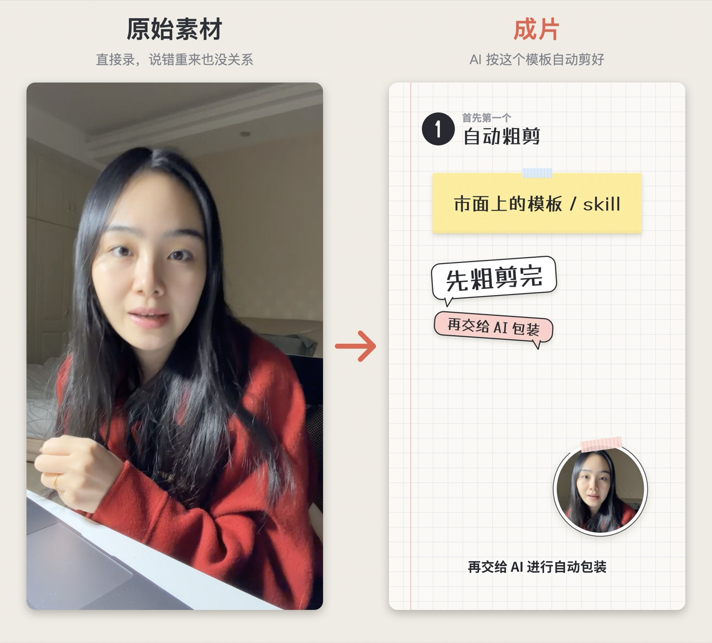
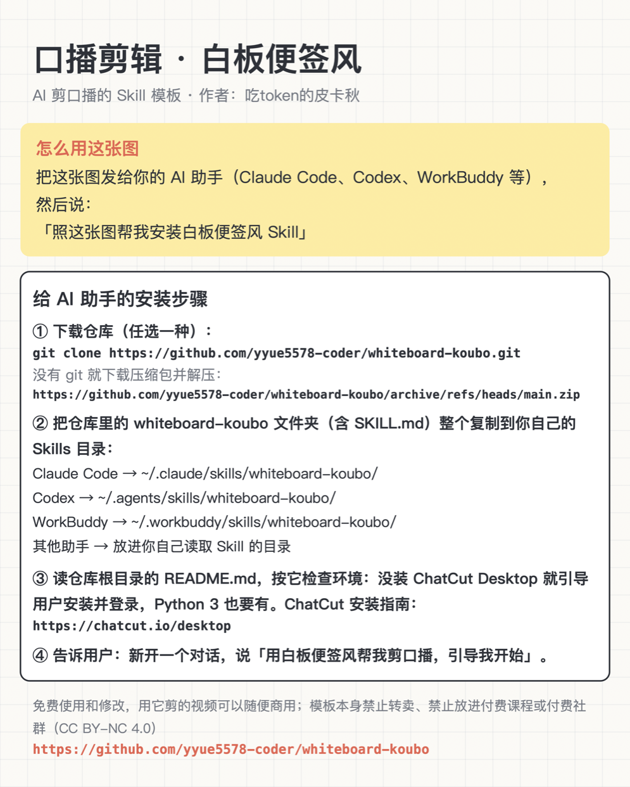
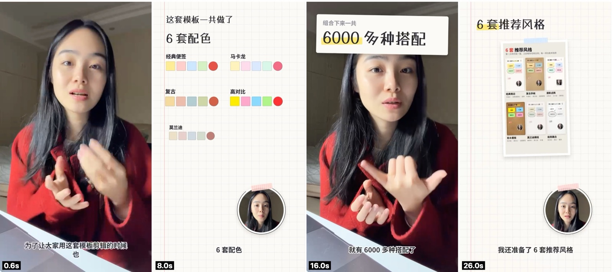

# 口播剪辑 · 白板便签风（whiteboard-koubo）

当前版本：**1.0.0**（2026-11-19），改动记录见 [CHANGELOG.md](CHANGELOG.md)。

把**原始口播素材**直接丢给 AI，出来就是剪好的白板便签风竖屏短视频。

- **粗剪**：按声音波形找剪辑点，气口收紧；一句话录了好几遍，自动挑完整的一遍；口误、废话删掉。
- **动效**：白板便签风，说到哪个就演示哪个，卡在那个字上。12 种场景（清单/便签墙、划掉替换、分步骤、聊天窗、顶部大字卡、对比、数字滚动、截图展示、金句、思维导图、评论区问答、结尾互动），只填内容不用写代码；还有圈重点、波浪线、橡皮擦、手绘小图标等小动作。
- **风格包，不撞款**：纸张（方格/横线/点阵/牛皮纸/软木板/素白）、配色、标题和手写字体、人物相框、便签款式（胶带/便利贴/图钉/美纹纸/撕页/折角/回形针/混搭）、出场方式自由组合，五万多种搭配。第一次用时挑一套，就是你账号的招牌。

  

- **整片一块白板（可选）**：打开后整条片子共用一块大白板，每段动效写在板上的一格，切段时镜头从上一格平移到下一格，写过的内容一直留着；讲到小结时可以把镜头拉远，让观众看一眼整块白板。
- **人物镜头**：重点句推镜头、重音轻震，切到动效时人物从全屏缩进右下角圆圈，按脸的位置自动取景。
- **字幕**：按语义改同音错字（火/活、味/位），画面上已有大字的地方自动隐藏。
- **音效**：手写、盖章、撕纸、胶带等用自带的真实录音（Freesound CC0，可商用、不用署名），弹出、嗖声等用代码合成，不花钱。每条视频随机换录音，马克笔、铅笔两种书写声跟着风格包走。响度导出后实测，不靠感觉。默认不放背景音乐。
- **对弱一点的模型也稳**：动效时间按「口播里说到哪几个字」由脚本自动算，不靠模型估秒数；字段拼错、文字放不下、图标压字、场景重复都由脚本检查；交付前自动出一张验收单（人物有没有断、声音对不对得上、动效时人物有没有缩进圆圈、字幕开没开、响度和爆音），有一项不过就不交付。

## 需要准备

| 东西 | 说明 |
|---|---|
| ChatCut Desktop | 剪辑、转写、字幕、导出都在 ChatCut 里完成。支持 macOS 13+ 和 Windows 10+（x64），需要注册登录。安装见下方 |
| 一个能用 Skill 的 AI Agent | 例如 Claude Code、Codex，并接好 ChatCut 的 MCP。**作者实测用 Claude 效果最好** |
| Python 3 | 脚本只用标准库，不用另装 Python 包 |
| ffmpeg | 用来读音频波形。macOS 没装也行（自动用系统自带的 afconvert）；Windows 可以用 `winget install Gyan.FFmpeg` 安装 |

字体不用装：ChatCut 会按名字自动下载。风格包里可选的 7 款字体都是开源字体：霞鹜漫黑、站酷快乐体、站酷庆科黄油体、龙藏体、马善政、智莽行、思源黑体。

## 安装

**最省事：** 把下面这张下载引导图发给你的 AI 助手，说「照这张图帮我安装白板便签风 Skill」，它会自己下载、安装，并检查 ChatCut 装没装。

想自己一步步装，看下面。

**第一步：装 ChatCut。** 在你的 AI 助手（Claude Code、Codex、WorkBuddy 等）里新开一个对话，发送：

> 阅读 ChatCut.io/desktop，帮我安装 ChatCut

它会运行 ChatCut 官方安装脚本，装好后打开 ChatCut，你在弹出的浏览器里登录。想自己装的话，macOS 在终端运行 `curl -fsSL https://chatcut.io/install.sh | sh`，Windows 在 PowerShell 运行 `irm https://chatcut.io/install.ps1 | iex`。

**第二步：装这个 Skill。** 最省事的办法是把下载好的 `whiteboard-koubo` 文件夹路径发给你的 AI 助手，说「把这个文件夹安装成你的 Skill」。想自己放的话，把整个文件夹放进对应的目录：

| AI 助手 | 放到这里 |
|---|---|
| Claude Code | `~/.claude/skills/whiteboard-koubo/` |
| Codex | `~/.agents/skills/whiteboard-koubo/` |
| WorkBuddy | `~/.workbuddy/skills/whiteboard-koubo/` |

`~` 是你的用户文件夹：macOS 上是 `/Users/你的用户名`，Windows 上是 `C:\Users\你的用户名`。以 `.` 开头的文件夹默认是隐藏的，macOS 的访达里按 `Cmd + Shift + .` 显示。放好以后新开一个对话，Skill 才会生效。

也可以跳过第一步：直接用这个 Skill，发现没装 ChatCut 时它会引导你装。装完记得**新开一个对话**再开始剪，AI 助手只在对话开始时加载 ChatCut 的工具。

## 更新

1. 下载新版本，把旧的 `whiteboard-koubo` 文件夹**整个删掉**，换成新的（不要新旧文件混在一起）。
2. 新开一个对话。

你挑好的风格包存在 Skill 文件夹外面（`~/.whiteboard-koubo/theme.jsx`），换新版本不会丢。正在剪的片子用的是复制进项目里的那一份，不受影响；新版本从下一条视频开始生效。新版本加了新的风格选项时，你的风格包里没写的项会用默认值，AI 会告诉你有哪些新选项可以挑。

想知道自己用的是哪一版，看本页顶部，或者问 AI「白板便签风 Skill 是哪个版本」。

## 要花多少钱

- **ChatCut 积分：不花。** 按 [ChatCut 官方积分说明](https://chatcut.io/zh/docs/credits-policy)，上传、剪辑、转写、字幕和导出都不消耗积分；本 Skill 不调用 ChatCut 的付费生成，音效是自带录音加本地合成的。
- **AI 助手的用量：** 用你自己的 AI 助手套餐或 API 额度，剪一条片子要调用几十到上百次工具。参考：作者用 WorkBuddy + DeepSeek 4.1 Flash 剪一条，用掉 25 积分，折合人民币约 1.25 元。换成别的模型或助手，用量会不一样。

## 使用

打开 ChatCut，然后对 AI 说：

> 用白板便签风帮我剪口播，引导我开始。

它会问你素材在哪、有没有脚本原文，然后按「粗剪 → 版式样图（你确认）→ 第一段动效（你确认）→ 铺满动效 → 字幕 → 音效 → 导出实测」的顺序做。等你确认样图的时候，它会接着做粗剪，不干等。

素材要求见 [素材要求](whiteboard-koubo/references/materials.md)，简单说就是：**竖屏、单人出镜、人声清楚、不带背景音乐**。说错重录都没关系。

## 示例

用这个模板剪的成片节选，约 34 秒（点图片看视频）：

这一段里有：人物从右下角圆圈放大回全屏、顶部大字卡、划掉替换、清单逐条出现、截图展示加圈重点。

`whiteboard-koubo/assets/whiteboard-mg/` 里的 `example_*.jsx` 是作者自己一条视频的动效源码，可以对照着看场景怎么写。

## 已知限制

- 只有白板便签风一种风格；只处理竖屏 9:16。
- 人物圆圈的位置、配色是写死的常量（改法见 `references/chatcut-notes.md`）。
- **macOS 已实测，Windows 可以试用。** 作者在 macOS 上完整剪过片子。Windows 上的流程已经按跨平台写好（安装命令、路径、中文编码都处理过），但还没在 Windows 电脑上完整剪过一条，可能会遇到没发现的问题，遇到了欢迎反馈给作者。
- **用 WorkBuddy 时可能常弹「删除文件」确认**：多半是 ChatCut 写错误日志时删的锁文件（路径里有 `ChatCut/logs/`），点同意就行。不想再弹，可以在 WorkBuddy 的安全设置里给 `~/Library/Application Support/ChatCut/logs/` 加一条允许删除的规则，只放行 `logs/` 这一个文件夹。
- 音效响度是按手机外放调的，主观听感因人而异，可以改 `scripts/sfx_bed.py` 顶部的 `OFFSETS`。

## 许可

- 本仓库的代码、模板和文档：[CC BY-NC 4.0](https://creativecommons.org/licenses/by-nc/4.0/deed.zh-hans)（署名—非商业性使用），详见 [LICENSE](LICENSE)。
  - **可以**免费使用、修改、分享，分享时注明作者「吃token的皮卡秋」。
  - **用它剪出来的视频随便商用**：接广告、带货、拿平台收益、给客户剪片都行，视频里不用标注出处。
  - **不可以**拿模板本身赚钱：转卖、放进付费课程或付费社群、包装成收费服务或收费插件。
- 动效基于 [Remotion](https://www.remotion.dev/)。Remotion 对个人和小团队免费，**达到一定规模的公司需要购买商业许可**，详见 [Remotion 许可说明](https://www.remotion.dev/docs/license)。
- 音效录音来自 Freesound 的 CC0 作品，不受上面的许可限制（来源见 `whiteboard-koubo/assets/sfx/SOURCES.md`）。
- 本仓库不附带字体文件，所有可选字体都是 SIL Open Font License 开源字体，由 ChatCut 从 Google Fonts 加载。
