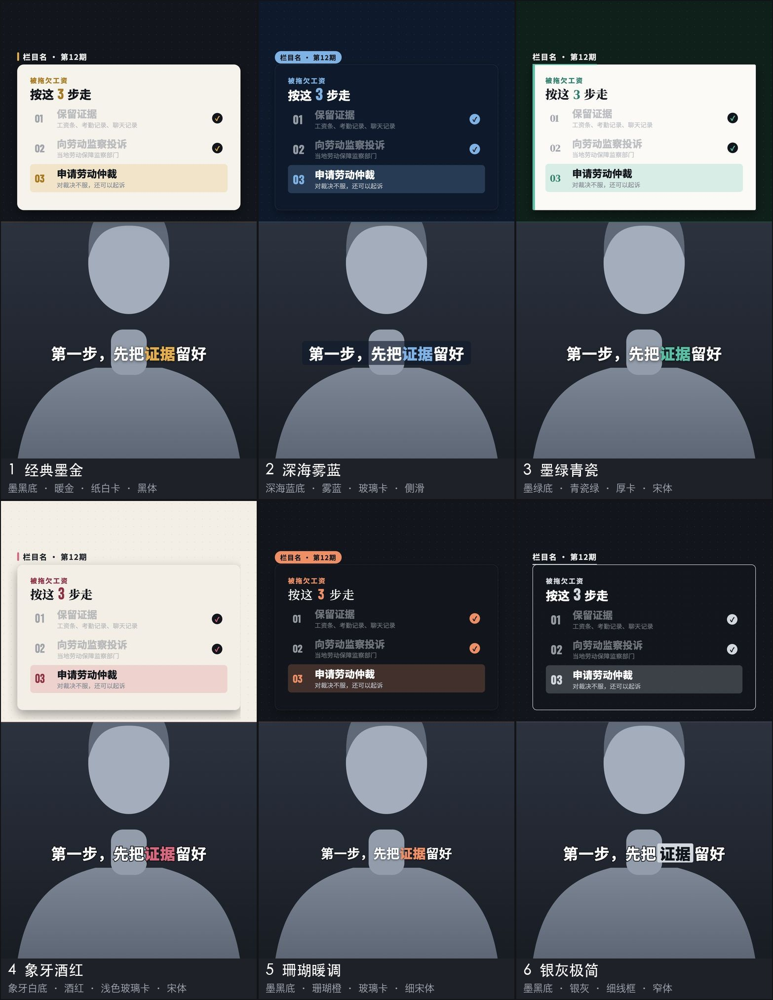

# premium-talk-edit · 口播剪辑「高级感干货风」

把口播 / 出镜讲话视频，在 [ChatCut](https://chatcut.io) 里交给 AI 助手剪成**克制、专业、可信**的竖屏短视频（9:16）。适合律师、医生、财税、保险、教育、职场这类讲干货的账号：人是主角，卡片讲清楚就退场，全片只有一个强调色。

> **用之前先确认这三样都有：**
> 1. **ChatCut 桌面版**（已登录）——卡片是 ChatCut 动效功能渲染的，剪映、Premiere 等别的软件用不了。
> 2. **一个能读 Skill、能调用 ChatCut 的 AI 助手**（Cindy / Claude Code / Codex 等）。
> 3. **macOS 或 Windows 电脑**（Windows 要多装一个免费的 ffmpeg，助手会问你）。

**安装：** 对你的 AI 助手说——

> 帮我安装这个剪辑 Skill：https://github.com/yyue5578-coder/koubo-templates/tree/main/premium-talk-edit

觉得好用的话，欢迎到[仓库首页](https://github.com/yyue5578-coder/koubo-templates)点右上角的 ☆ Star，让更多人看到。



## 你会得到什么

- **28 种信息卡**：开头钩子 4（钩子大字、问句、数字、反常识）· 叠在人物上 5（名词卡、身份条、金句、提示条、章节过场）· 数据 8（大数字、两数对比、百分比环、条形图、时间轴、对比表、以为/其实、公式拆解）· 原文和互动 8（法条原文、截图标注、聊天记录、步骤、自查清单、流程图、评论问答、片尾收藏）· 新增 3（折线图、三合一、省时间加分数）。口播里常见的每种句式，都有 2–3 种卡可以换着用。预览见 `assets/previews/cards.jpg`（新增的 3 种还没进预览图）。
- **一套可换的风格包**：6 种强调色 × 4 种底色 × 4 种卡片质感 × 3 种标题字体 × 4 种数字字体 × 5 种进场 × 4 种字幕 × 4 种标签，约 9.2 万种组合；6 套推荐组合直接选。
- **卡片时间自动算**：每张卡的 SPEC 里写口播原话的几个字（`"countSay":"三年"`），脚本按口播实际说到的时刻换算成秒数，不用手填。
- **音效自动配**：8 类 24 个音效（CC0 / CC BY），按场合自动分配——同一条视频里同一动作的声音固定、同类不同场合用不同变体、换视频名换一套组合；响度跟人声走。
- **三种版式自动切换**：卡片叠在人物上（A）；顶部深色底 + 卡片、人物下移（B）；整屏讲解、人物缩进左下圆窗（C）。
- **导出后自动验收**：核对时间线结构、人物位置、圆窗、人声是否重叠、音效响度，有 ❌ 不交付。

## 怎么用

1. 装：对助手说「帮我安装这个剪辑 Skill：https://github.com/yyue5578-coder/koubo-templates/tree/main/premium-talk-edit」。想自己装看 [INSTALL.md](INSTALL.md)（不需要安装 Python 依赖）。
2. 对助手说：
   > 用 premium-talk-edit，把 ~/Desktop/口播.mov 剪成高级感干货风的竖屏短视频。
3. 助手会先给你看风格对照，选一套；再粗剪、给你一张「口播原话 → 画面上出什么」的对照表确认、做第一段给你看，确认后铺满，配字幕和音效，验收后交付。
4. 听一遍音效。不喜欢哪个声音，说一声，助手会把它禁用，以后不再出现。

## 素材要求

- 竖屏 9:16、1080×1920、30fps 最好（不是这个比例时助手会先和你确认怎么裁）。
- 人声清楚；人物脸在画面中上部、正对镜头（顶部要留位置给卡片，B 版式人物会下移 200 px）。
- 素材里已经烧录了字幕时，可以用 `assets/effects/subband.js` 把字幕条糊掉再盖上新字幕（见 `references/theme.md`）。
- **卡片上的数字、法条、金额必须是口播里说的**，示例里的内容只是演示版式。

## 已知限制（请先看）

- **只在 ChatCut 里能用。** 卡片是 Remotion 代码，靠 ChatCut 的动效功能渲染；在剪映、Premiere 等别的软件里不能直接用。
- **系统：macOS 和 Windows 都能用。** 主要在 macOS 上开发和测试；同一套粗剪、音频测量、验收脚本已经在 Windows 上跟着作者的另一套模板（白板便签风）测过。Windows 上要装 ffmpeg，运行脚本前设 `PYTHONUTF8=1`（助手会处理）；找脸和抽帧拼图的两个小工具只有 macOS 有，Windows 上助手改用 ChatCut 抽帧看图估算。
- **用两条真实口播完整走通过**（一条约 2 分钟的连麦口播，另一条新录的口播），还没在别人的机器上从零装过。换一条脸位置、语速不同的素材，字幕位置和人物下移量可能要调；遇到问题欢迎提 Issue。
- **音效是按规则自动挑的**：每条视频里怎么搭配由脚本按场合分配，AI 自己听不到。交付后请你听一遍，不喜欢哪个声音告诉助手，它会禁用掉。
- **使用中的限制**：C 版式（流程图、全屏表格/时间轴）里字幕会靠近左下圆窗；片尾收藏卡的字幕位置和卡片内容有重叠，用 ChatCut 原生字幕时建议片尾把字幕轨隐藏；银灰配色的卡片标题数字接近白色，只靠字号突出。
- **字体靠联网**：Noto Sans/Serif SC、Barlow Condensed、Oswald、Bebas Neue、DM Serif Display 由 ChatCut 从 Google Fonts 下载，断网会回退成系统字体，样子会变。
- **示例内容不是专业建议**：示例里的法律、医疗、财税文字只是演示版式，不是真实数据，也不构成专业意见。你自己的视频里卡片内容要对自己说的话负责。

## 目录

```
premium-talk-edit/
├── SKILL.md              给 AI 助手看的剪辑流程（入口）
├── INSTALL.md            安装和自检
├── README.md             本文件
├── CHANGELOG.md  VERSION 更新记录和版本号
├── LICENSE  THIRD_PARTY.md   许可；音效、字体的来源和署名文字
├── assets/
│   ├── mg/               组件库：theme.jsx（风格包）、lib.jsx（底座）、scenes*.jsx（28 种卡片）、gallery/combos（演示合集）
│   ├── sfx-pool/         音效池：24 个 wav、pool.json（来源、测量、规则）、CREDITS.md
│   ├── effects/          像素特效：糊掉素材自带字幕条
│   └── previews/         预览图（无真人）
├── scripts/              粗剪、定时、版式、音效、验收的脚本（只用 Python 标准库）
├── references/           workflow（流程细节）、scenes（每张卡的字段和选卡规则）、theme、sfx、captions、chatcut-notes、authoring（新增卡片）、troubleshooting
└── examples/demo/        3 段示例 SPEC + 一份虚构口播的逐词时间，不需要 ChatCut 就能跑
```

## 许可

- 本文件夹的代码、模板和文档：[CC BY-NC 4.0](https://creativecommons.org/licenses/by-nc/4.0/deed.zh-hans)（署名—非商业性使用），详见 [LICENSE](LICENSE)。
  - **可以**免费使用、修改、分享，分享时注明作者「吃token的皮卡秋」。
  - **用它剪出来的视频随便商用**：接广告、带货、拿平台收益、给客户剪片都行，视频里不用标注本模板。
  - **不可以**拿模板本身赚钱：转卖、放进付费课程或付费社群、包装成收费服务或收费插件。
- 动效基于 [Remotion](https://www.remotion.dev/)。Remotion 对个人和小团队免费，**达到一定规模的公司需要购买商业许可**，详见 [Remotion 许可说明](https://www.remotion.dev/docs/license)。
- 音效来自 Freesound，按各自的 CC0 / CC BY 许可使用；视频里用到 CC BY 的 6 个时要署名（助手交付时会给你署名清单），见 [THIRD_PARTY.md](THIRD_PARTY.md)。
- 不附带字体文件，所有字体都是 SIL Open Font License 开源字体，由 ChatCut 从 Google Fonts 加载。

## 反馈和贡献

遇到问题先看 [references/troubleshooting.md](references/troubleshooting.md)。想新增卡片看 [references/authoring.md](references/authoring.md)。有问题或建议请提 [Issue](https://github.com/yyue5578-coder/koubo-templates/issues)。

作者：吃token的皮卡秋。这套模板免费分享，觉得有用的话点个 ☆ Star 就是最好的支持。
